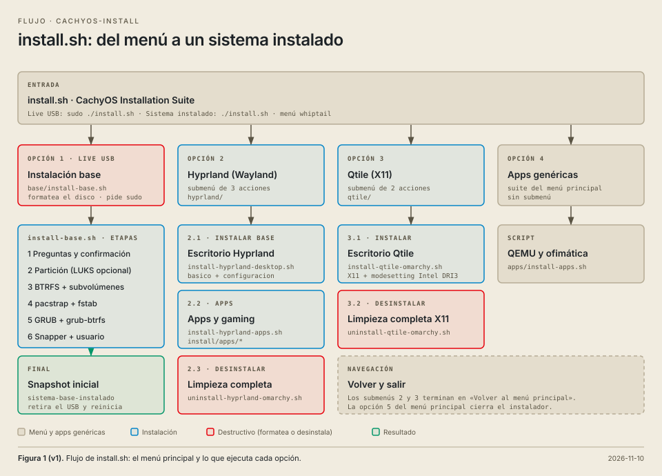

# CachyOS + Omarchy Installer


Modular CachyOS installer based on Omarchy with additional customizations, integrated documentation and support for Hyprland and Qtile.

## Features

- CachyOS + BTRFS + Snapper.
- Modular Hyprland setup.
- Persistent monitor management with nwg-displays.
- Customized Waybar.
- Per-application audio controls.
- Integrated screenshot tools.
- Qtile support.
- Technical handbook.

## Screenshot Shortcuts

- Print: Area screenshot.
- Super + Print: Full screenshot.
- Super + Shift + Print: Active window.
- Ctrl + Print: Copy screenshot to clipboard.

## Installation

```bash
git clone https://github.com/terracenter/cachyos-install.git
cd cachyos-install
./install.sh
```

## Installation flow



## License

GPL-3.0 (see `LICENSE`). Based on Omarchy (MIT); its notice is in `THIRD-PARTY-LICENSES.md`.
